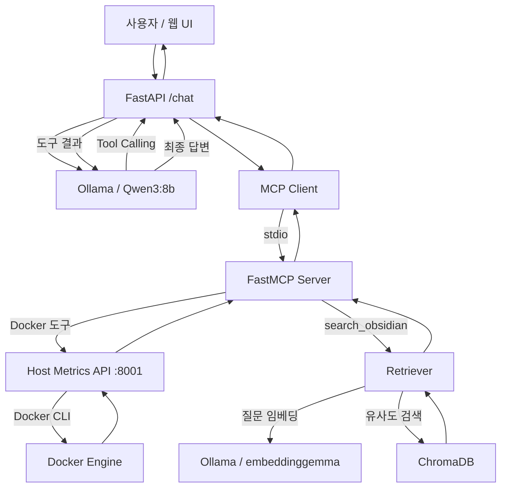

# Agent Lab

**MCP 기반 Docker 운영 장애 진단 및 RAG 문서 검색 AI Agent**

Agent Lab은 자연어 질문에 따라 Docker 운영 정보를 조회하거나 Obsidian 문서를 검색하고, 수집한 데이터를 바탕으로 답변하는 Python 백엔드 프로젝트입니다.

LLM이 질문에 필요한 도구를 선택하고, MCP를 통해 실제 데이터를 조회한 뒤 결과를 해석하는 흐름을 구현했습니다.

주요 기능은 다음 두 가지입니다.

- **Docker 운영 장애 진단:** 컨테이너 상태와 로그를 조회하고 장애 원인 및 권장 조치 설명
- **RAG 문서 검색:** Obsidian Markdown 문서를 ChromaDB에 저장하고 의미 기반 검색 결과를 활용한 답변 생성

## 아키텍처



Docker 운영 데이터는 macOS 호스트의 Host Metrics API에서 조회합니다. RAG 검색은 API 컨테이너에 저장된 ChromaDB를 사용합니다.

## 기술 스택

| 영역 | 기술 |
| --- | --- |
| Backend | Python, FastAPI, HTTPX |
| LLM | Ollama, Qwen3:8b |
| Embedding | embeddinggemma |
| Tool Protocol | MCP, FastMCP, stdio |
| RAG / Vector DB | Markdown, ChromaDB |
| Runtime | Docker, Docker Compose, macOS |
| Frontend | HTML, JavaScript, Marked, DOMPurify |
| Testing | pytest, pytest-asyncio, unittest.mock |

## MCP 도구

| 도구 | 역할 |
| --- | --- |
| `get_host_status` | 호스트 CPU·메모리 상태 조회 |
| `get_container_status` | 실행 중인 Docker 컨테이너 CPU·메모리 조회 |
| `get_container_details(container_id)` | 컨테이너 실행 상태, 재시작 횟수, OOM 여부 조회 |
| `get_container_logs(container_id, tail=100)` | 최근 컨테이너 로그 조회 |
| `search_obsidian(query)` | Obsidian 문서의 의미 기반 검색 |

모든 MCP 도구는 읽기 전용이며, 컨테이너 재시작이나 삭제, 문서 수정 등의 작업은 수행하지 않습니다.

## RAG 구현

### 문서 처리

Obsidian Vault의 Markdown 파일을 읽어 문서 단위로 로딩합니다.

현재 구현에서는 문서를 500자 단위로 분할하고, 각 청크에 원본 문서명, 경로, 청크 번호를 부여합니다.

### 임베딩 및 저장

Ollama의 `embeddinggemma` 모델을 사용해 각 청크를 768차원 벡터로 변환합니다.

생성한 임베딩과 원문, 메타데이터를 ChromaDB에 저장합니다.

### 문서 검색

사용자의 질문을 동일한 임베딩 모델로 벡터화하고, ChromaDB에서 유사한 청크 3개를 검색합니다.

검색 결과는 `search_obsidian` MCP 도구를 통해 LLM에 전달됩니다.

LLM은 전달된 문서 내용을 바탕으로 답변을 생성하며, 시스템 프롬프트에서 검색 근거와 문서 출처를 표시하도록 지시합니다.

### 구현 검증

로컬 Obsidian Vault를 대상으로 다음 흐름을 확인했습니다.

- Markdown 문서 39개 로딩
- 청크 201개 생성 및 ChromaDB 저장
- 질문 임베딩 및 유사 문서 검색
- Ollama의 `search_obsidian` MCP 도구 선택
- MCP `CallToolRequest` 실행 및 임베딩 API 정상 응답
- 웹 UI에서 검색 문서를 활용한 답변 생성

위 수치는 개발 환경에서 확인한 초기 검증 결과이며, 고정된 성능 지표는 아닙니다.

## Docker 장애 재현 및 검증

별도 `fault-lab/` Docker Compose 프로젝트에서 두 가지 장애를 재현했습니다.

### 1. 필수 환경변수 누락

`DATABASE_URL`이 없는 상태로 컨테이너를 시작해 `Exited (1)`과 환경변수 누락 오류를 확인했습니다.

Agent가 컨테이너 상태와 로그를 조회하고 필수 환경변수 누락을 원인으로 설명한 사례를 검증했습니다.

### 2. 컨테이너 내부 연결 실패

실행 중인 컨테이너 내부에서 수신 프로세스가 없는 `127.0.0.1:5432`로 연결을 시도했습니다.

`ConnectionRefusedError` 로그를 통해 컨테이너 실행 상태와 애플리케이션 연결 오류를 구분하는 진단 사례를 확인했습니다.

이 실험은 실제 PostgreSQL 서버 장애를 재현한 것은 아닙니다.

## 로컬 실행

### 1. 환경변수 설정

프로젝트 루트의 `.env` 파일에 설정합니다.

```dotenv
LLM_PROVIDER=ollama
OLLAMA_BASE_URL=http://ollama:11434
OLLAMA_MODEL=qwen3:8b
OBSIDIAN_VAULT_PATH=/path/to/your/obsidian/vault
```

`OBSIDIAN_VAULT_PATH`에는 로컬 Markdown 문서 폴더의 절대 경로를 지정합니다.

### 2. Docker Compose 실행

```bash
docker compose up -d --build
```

### 3. Ollama 모델 다운로드

```bash
docker compose exec ollama ollama pull qwen3:8b
docker compose exec ollama ollama pull embeddinggemma
```

### 4. Host Metrics API 실행

macOS 호스트에서 실행합니다.

```bash
uvicorn app.host_metrics:app --host 0.0.0.0 --port 8001
```

현재 Host Metrics API에는 인증 기능이 없으므로 신뢰할 수 없는 네트워크에 공개하지 않아야 합니다.

### 5. RAG 데이터 준비

Obsidian Markdown 문서를 로딩하고, 청킹 및 임베딩을 수행한 뒤 ChromaDB에 저장합니다.

```bash
docker compose exec api python -m app.rag.vector_store
```

인덱싱이 완료되면 컬렉션 이름과 저장된 청크 수가 출력됩니다.

동일한 ID의 데이터는 `upsert()`로 갱신되지만, 원본에서 삭제된 문서나 청크는 자동으로 제거되지 않습니다.

### 6. 웹 UI

브라우저에서 `http://localhost:8000`으로 접속합니다.

## 자동화 테스트

```bash
python -m pytest tests/ -v
```

**기존 테스트 결과: 13 passed (2026-10-16)**

검증 항목은 Docker 상태 조회와 로그 처리, MCP 도구 변환 및 오류 처리, LLM 다단계 Tool Calling, 캐시 및 라운드 제한입니다.

신규 RAG 기능은 수동 E2E 검증을 완료했으며, 별도의 자동화 회귀 테스트는 아직 추가하지 않았습니다.

## 설계 판단 및 한계

### LLM의 도구 선택

MCP 도구 목록을 동적으로 조회해 Ollama에 전달합니다. 도구 호출 여부는 LLM이 판단합니다.

Docker 진단 전용 시스템 프롬프트에서는 문서 검색 도구가 선택되지 않았으나, 문서 검색 역할을 추가한 후 실제 `search_obsidian` 호출을 확인했습니다.

### RAG 검색 정확도

현재 500자 단위 청킹과 상위 3개 검색 결과를 사용합니다. 문장 또는 Markdown 표가 중간에 분리될 수 있으며, 관련성이 낮은 검색 결과가 포함될 수 있습니다.

검색 정확도와 답변 품질에 대한 정량 평가는 아직 수행하지 않았습니다.

### 문서 동기화

Obsidian 원본 문서의 변경 사항은 ChromaDB에 자동 반영되지 않습니다. 변경된 문서는 별도로 다시 인덱싱해야 합니다.

### 개인정보 보호

실제 Obsidian 문서와 ChromaDB 저장 데이터는 Git 저장소에서 제외합니다.

### 운영 보안

인증, 접근 제어, 로그 비식별화 및 외부 공개를 위한 보안 강화는 현재 구현 범위 밖입니다.

### 로컬 LLM 응답 지연

CPU 기반 Qwen3:8b에서 여러 차례 Tool Calling을 수행하면 응답 시간이 길어질 수 있습니다.

## 프로젝트에서 검증한 역량

Python 백엔드 개발 및 운영 경험을 기반으로 다음 흐름을 구현했습니다.

**운영 데이터 수집 → MCP 도구 설계 → LLM Tool Calling → RAG 검색 → 근거 기반 답변 → 장애 재현 및 테스트**

Agent Lab은 자동 복구 시스템이 아니라, 운영 데이터와 문서 검색 결과를 활용해 사용자의 판단을 보조하는 AI Agent 구조를 검증하는 프로젝트입니다.
