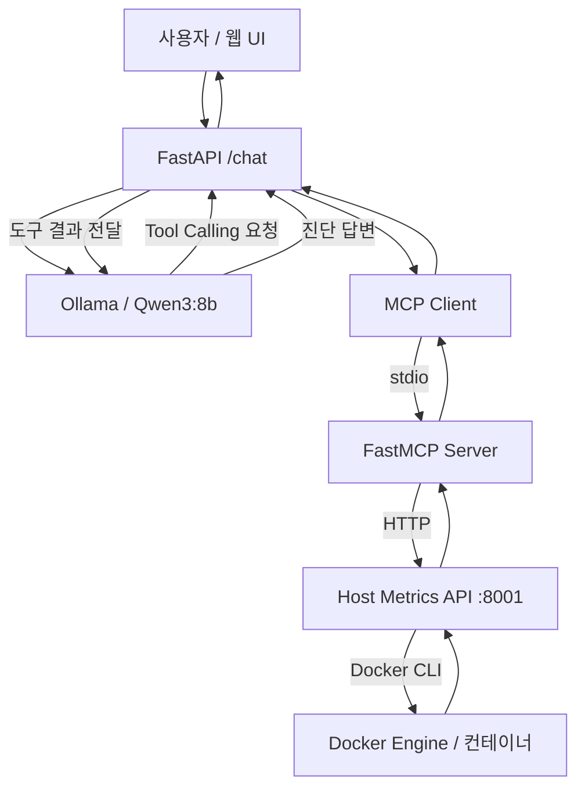

# Agent Lab

**MCP 기반 Docker 운영 장애 진단 AI Agent**

Agent Lab은 사용자의 자연어 질문을 받아 Docker 컨테이너와 호스트의 운영 정보를 조회하고, 조회한 상태·로그를 근거로 장애 원인과 권장 조치를 설명하는 백엔드 포트폴리오 프로젝트입니다.

단순히 LLM에 질문하는 챗봇이 아니라, **LLM Tool Calling → MCP 도구 실행 → 실제 운영 데이터 조회 → 진단 결과 생성** 흐름을 구현하는 데 집중했습니다.

## 아키텍처



- **웹 UI / API:** FastAPI가 `/chat` 요청을 받고 LLM 응답을 웹 화면에 표시합니다. Markdown은 Marked로 렌더링하고 DOMPurify로 정화합니다.
- **LLM Provider:** Ollama Chat API를 호출하고 Tool Calling 결과를 대화에 반영합니다.
- **MCP Client / Server:** MCP 도구 스키마를 동적으로 읽고 운영 데이터를 요청합니다.
- **Host Metrics API:** macOS 호스트에서 Docker CLI를 통해 상태와 로그를 조회합니다.

> MCP 서버가 Docker에 직접 접근하는 구조가 아닙니다. Docker CLI에 접근 가능한 호스트 측 API가 운영 정보를 수집하고 MCP 서버가 이를 중계합니다.

## 기술 스택

| 영역 | 기술 |
| --- | --- |
| Backend | Python, FastAPI, HTTPX |
| LLM | Ollama, Qwen3:8b, Tool Calling |
| Tool Protocol | MCP, FastMCP, stdio |
| Runtime | Docker, Docker Compose, macOS |
| Frontend | HTML, JavaScript, Marked, DOMPurify |
| Testing | pytest, pytest-asyncio, unittest.mock |

## MCP 도구

| 도구 | 역할 |
| --- | --- |
| `get_host_status` | 호스트 CPU·메모리 상태 조회 |
| `get_container_status` | 실행 중인 컨테이너의 CPU·메모리 상태 조회 |
| `get_container_details(container_id)` | 실행/종료 상태, 재시작 횟수, OOM 여부, 종료 코드 조회 |
| `get_container_logs(container_id, tail=100)` | 최근 컨테이너 로그 조회 (최대 200줄 요청) |

현재 MCP 도구는 **읽기 전용**입니다. 컨테이너 재시작, 삭제, 설정 변경 등의 자동 조치는 수행하지 않습니다.

## 동작 흐름

1. 사용자가 특정 컨테이너의 장애 원인을 자연어로 질문합니다.
2. LLM이 필요한 MCP 도구와 인자를 선택합니다.
3. 백엔드가 MCP 도구를 호출하고 Host Metrics API를 통해 상태와 로그를 조회합니다.
4. 조회 결과를 LLM에 전달하고, 필요한 경우 다음 도구를 호출합니다.
5. LLM이 관측된 사실, 장애 원인, 권장 조치, 추가 확인 사항을 정리합니다.

동일 요청 내에서는 **동일 도구·동일 인자 결과 캐시**를 사용하며, 도구 호출 대화는 최대 10라운드로 제한합니다.

도구 실행 예외는 오류 정보로 변환하여 LLM에 전달합니다.

> 10라운드는 도구 호출 총횟수 제한과 동일하지 않습니다.

## 장애 재현 및 검증

`fault-lab/`에 별도 Docker Compose 프로젝트를 구성하여 두 가지 장애 상황을 검증했습니다.

### 1. 필수 환경변수 누락으로 컨테이너 종료

**대상:** `fault-lab-api`

**재현 조건:** `DATABASE_URL`이 없는 상태로 애플리케이션 시작

**관측 결과:**

- 컨테이너 상태: `Exited (1)`
- 로그: `FATAL: DATABASE_URL environment variable is required`

**Agent 진단 결과:**

컨테이너 상태 및 로그를 조회하고 필수 환경변수 누락을 장애 원인으로 진단한 실행 사례를 확인했습니다.

### 2. 컨테이너는 Running이지만 내부 연결 실패

**대상:** `fault-lab-connection-error`

**재현 조건:** 컨테이너 내부에서 `127.0.0.1:5432`로 반복 연결 시도

**관측 결과:**

- 컨테이너 상태: `Running`
- 로그: `ConnectionRefusedError: [Errno 111] Connection refused`

**Agent 진단 결과:**

컨테이너 실행 상태와 애플리케이션 연결 오류를 구분하여 설명한 실행 사례를 확인했습니다.

> 이 시나리오는 컨테이너 내부 루프백 주소에 수신 프로세스가 없는 상황을 재현한 것입니다. 실제 운영 PostgreSQL 서버 장애 사례는 아닙니다.

### Fault Lab 실행

프로젝트 루트에서:

```bash
docker compose -p fault-lab -f fault-lab/docker-compose.yml up -d --build

docker ps -a --filter name=fault-lab

docker logs fault-lab-api
docker logs --tail 10 fault-lab-connection-error
```

실험 종료 후:

```bash
docker compose -p fault-lab -f fault-lab/docker-compose.yml down
```

## 자동화 테스트

실제 Docker CLI, MCP 프로세스 및 Ollama API를 Mock으로 대체한 자동화 테스트를 작성했습니다.

```bash
python -m pip install pytest pytest-asyncio
python -m pytest tests/ -v
```

**테스트 결과: 13 passed (2026-10-10, macOS / Python 3.11.9)**

검증 항목:

- Docker 상태 파싱, 종료 상태, 로그 조회 제한, Docker CLI 실패
- MCP 도구 스키마 변환, 구조화 결과 반환, 도구 오류 처리
- LLM 다단계 Tool Calling, 동일 요청 내 캐시, 도구 예외 전달, 라운드 제한

> 자동화 테스트는 Mock 기반 단위 테스트이며, 장애 시나리오 2종은 실제 Docker 환경에서 별도로 수행한 수동 검증입니다.


## 로컬 실행 방법

### 1. 환경변수 설정

프로젝트 루트에 `.env` 파일을 생성합니다.

```env
LLM_PROVIDER=ollama
OLLAMA_BASE_URL=http://ollama:11434
OLLAMA_MODEL=qwen3:8b
```

OpenAI Provider 관련 설정은 선택 사항입니다.

### 2. Docker Compose 실행

```bash
docker compose up -d --build
```

### 3. Ollama 모델 다운로드

```bash
docker compose exec ollama ollama pull qwen3:8b
```

### 4. Host Metrics API 실행

호스트의 Python 환경에서 실행합니다.

```bash
uvicorn app.host_metrics:app --host 0.0.0.0 --port 8001
```

Host Metrics API는 macOS 호스트의 Docker CLI를 사용합니다.

### 5. 웹 UI 접속

브라우저에서 다음 주소로 접속합니다.

http://localhost:8000

### 6. 자동화 테스트

```bash
python -m pytest tests/ -v
```

검증 결과: **13 passed**

> 현재 Host Metrics API에는 인증 기능이 없으므로 신뢰할 수 없는 네트워크에 공개하지 않아야 합니다.


## 설계 판단 및 한계

### 읽기 전용 진단

운영 환경에 대한 의도치 않은 변경을 방지하기 위해 MCP 도구에서 컨테이너 조작 기능을 제외했습니다.

### 근거 중심 진단

상태와 로그를 조회해 답변하도록 시스템 프롬프트를 구성했습니다. 다만 LLM이 모든 상황에서 지침을 반드시 준수한다고 보장할 수는 없습니다.

### 제한된 로그 조회

로그 조회 요청은 1~200줄로 제한하며, Docker 로그 응답은 최대 20,000자로 제한합니다.

### 실행 상태 조회의 한계

`docker stats` 기반 목록은 실행 중인 컨테이너만 조회합니다. 종료된 컨테이너는 이름을 지정해 상세 조회해야 합니다.

### 응답 속도

로컬 CPU에서 실행한 Qwen3:8b는 다단계 도구 호출 시 응답 지연이 발생할 수 있습니다.

### 운영 보안

인증, 접근 제어, 로그 비식별화 및 외부 공개를 위한 보안 강화는 현재 구현 범위 밖입니다.

## 프로젝트에서 보여주고자 한 역량

Python 백엔드 개발 및 운영 경험을 바탕으로 다음 흐름을 하나의 시스템으로 구현했습니다.

**운영 데이터 수집 → MCP 도구 인터페이스 설계 → LLM 연동 → 오류 처리 → 장애 재현 → 자동화 테스트**

Agent Lab의 목표는 완전한 자율 복구 플랫폼이 아니라, **실제 운영 데이터를 활용해 장애 진단을 보조하는 MCP 기반 백엔드 구조를 검증하는 것**입니다.
