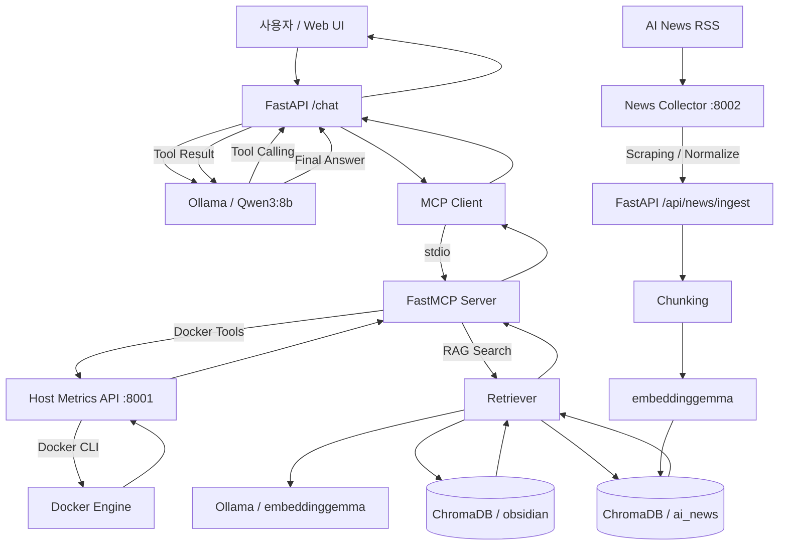

# Agent Lab

**MCP 기반 Docker 운영 장애 진단 및 멀티소스 RAG AI Agent**

Agent Lab은 자연어 질문에 따라 Docker 운영 정보를 조회하거나 RAG 데이터 소스를 검색하고, 실제 조회 결과를 바탕으로 답변하는 Python 백엔드 프로젝트입니다.

LLM이 질문에 필요한 도구를 선택하고 MCP를 통해 운영 데이터 또는 RAG 검색 결과를 조회한 뒤 답변을 생성하는 흐름을 구현했습니다.

주요 기능은 다음과 같습니다.

- **Docker 운영 장애 진단:** 컨테이너 상태와 로그를 조회하고 장애 원인 및 권장 조치 설명
- **Obsidian RAG 검색:** Markdown 문서를 ChromaDB `obsidian` 컬렉션에 저장하고 의미 기반 검색 결과를 활용한 답변 생성
- **AI 뉴스 수집 및 RAG:** RSS에서 AI 뉴스를 수집하고 기사 본문을 스크래핑·정규화한 뒤 ChromaDB `ai_news` 컬렉션에 저장하여 검색에 활용

## 아키텍처



Docker 운영 데이터는 macOS 호스트의 Host Metrics API를 통해 조회합니다.

RAG 데이터는 용도별 ChromaDB 컬렉션으로 분리했습니다.

- `obsidian`: 로컬 Obsidian Markdown 문서
- `ai_news`: RSS 수집 및 스크래핑한 AI 뉴스

뉴스 수집기는 Agent API와 분리된 `news_collector` 서비스로 구성했습니다.

## 기술 스택

| 영역 | 기술 |
| --- | --- |
| Backend | Python, FastAPI, HTTPX |
| LLM | Ollama, Qwen3:8b |
| Embedding | embeddinggemma |
| Tool Protocol | MCP, FastMCP, stdio |
| RAG / Vector DB | ChromaDB |
| Document Source | Obsidian Markdown |
| News Pipeline | RSS, HTTPX, Web Scraping |
| Runtime | Docker, Docker Compose, macOS |
| Frontend | HTML, JavaScript, Marked, DOMPurify |
| Testing | pytest, pytest-asyncio, unittest.mock |

## MCP 도구

| 도구 | 역할 |
| --- | --- |
| `get_host_status` | 호스트 CPU·메모리 상태 조회 |
| `get_container_status` | 실행 중인 Docker 컨테이너 CPU·메모리 조회 |
| `get_container_details(container_id)` | 컨테이너 실행 상태, 재시작 횟수, OOM 여부 조회 |
| `get_container_logs(container_id, tail=100)` | 최근 컨테이너 로그 조회 |
| `search_obsidian(query)` | Obsidian 문서 의미 기반 검색 |

모든 Docker 관련 MCP 도구는 읽기 전용이며 컨테이너 재시작이나 삭제 등의 작업은 수행하지 않습니다.

## RAG 구현

### 공통 처리

RAG 데이터는 다음 흐름으로 처리합니다.

```text
Source
  ↓
Document Loading / Collection
  ↓
Chunking
  ↓
Embedding
  ↓
ChromaDB Collection
  ↓
Retriever
  ↓
LLM
```

문서는 500자 단위로 분할하고 Ollama의 `embeddinggemma` 모델을 이용해 임베딩합니다.

검색 시 사용자의 질문도 동일한 임베딩 모델로 변환하고 ChromaDB에서 유사한 청크를 조회합니다.

### Obsidian RAG

Obsidian Vault의 Markdown 파일을 읽어 문서 단위로 로딩합니다.

각 청크에는 다음 메타데이터를 저장합니다.

- 원본 문서 경로
- 데이터 소스
- 청크 번호

데이터는 ChromaDB `obsidian` 컬렉션에 저장합니다.

초기 개발 과정에서 다음 흐름을 검증했습니다.

- Markdown 문서 39개 로딩
- 청크 201개 생성 및 ChromaDB 저장
- 질문 임베딩 및 유사 문서 검색
- `search_obsidian` MCP 도구 호출
- 웹 UI에서 검색 문서를 활용한 답변 생성

위 수치는 개발 환경에서 확인한 초기 검증 결과이며 고정된 성능 지표는 아닙니다.

### AI News RAG

외부 데이터 소스를 자동으로 수집하고 RAG 컬렉션을 분리해서 관리하는 구조를 실험하기 위해 AI 뉴스 수집 파이프라인을 추가했습니다.

```text
AI News RSS
    ↓
News Collector
    ↓
Article Scraping
    ↓
Normalize
    ↓
POST /api/news/ingest
    ↓
Chunking
    ↓
Embedding
    ↓
ChromaDB / ai_news
```

`news_collector`는 Agent API와 별도의 Docker 서비스로 실행합니다.

수집된 기사의 URL을 기반으로 ID를 생성하고 기사 제목, URL, 출처, 발행 시각, 청크 번호를 메타데이터로 저장합니다.

기사 본문이 비어 있는 경우 RAG 데이터로 저장하지 않고 `skipped` 처리합니다.

### AI News E2E 검증

실제 RSS를 대상으로 다음 흐름을 확인했습니다.

```text
RSS 수집
→ 기사 본문 스크래핑
→ 데이터 정규화
→ Agent API 전송
→ Chunk 생성
→ Embedding
→ ChromaDB ai_news 저장
→ Agent 검색
→ 뉴스 기반 답변 생성
```

테스트 과정에서 하나의 기사로부터 5개 청크가 생성되어 `ai_news` 컬렉션에 저장되는 것을 확인했고, 이후 Agent가 저장된 뉴스 내용을 검색해 답변하는 흐름을 확인했습니다.

## Docker 장애 재현 및 검증

별도 `fault-lab/` Docker Compose 프로젝트에서 두 가지 장애를 재현했습니다.

### 1. 필수 환경변수 누락

`DATABASE_URL`이 없는 상태로 컨테이너를 시작해 `Exited (1)`과 환경변수 누락 오류를 확인했습니다.

Agent가 컨테이너 상태와 로그를 조회하고 필수 환경변수 누락을 원인으로 설명하는 흐름을 검증했습니다.

### 2. 컨테이너 내부 연결 실패

실행 중인 컨테이너 내부에서 수신 프로세스가 없는 `127.0.0.1:5432`로 연결을 시도했습니다.

`ConnectionRefusedError` 로그를 통해 컨테이너 실행 상태와 애플리케이션 연결 오류를 구분하는 진단 사례를 확인했습니다.

이 실험은 실제 PostgreSQL 서버 장애를 재현한 것은 아닙니다.

## 로컬 실행

### 1. 환경변수 설정

프로젝트 루트의 `.env` 파일에 설정합니다.

```dotenv
LLM_PROVIDER=ollama
OLLAMA_BASE_URL=http://ollama:11434
OLLAMA_MODEL=qwen3:8b
OBSIDIAN_VAULT_PATH=/path/to/your/obsidian/vault
```

### 2. Docker Compose 실행

```bash
docker compose up -d --build
```

실행 서비스:

| Service | Port |
| --- | ---: |
| Agent API | 8000 |
| Host Metrics API | 8001 |
| News Collector | 8002 |
| Ollama | 11434 |

### 3. Ollama 모델 다운로드

```bash
docker compose exec ollama ollama pull qwen3:8b
docker compose exec ollama ollama pull embeddinggemma
```

### 4. Host Metrics API 실행

macOS 호스트에서 실행합니다.

```bash
uvicorn app.host_metrics:app --host 0.0.0.0 --port 8001
```

현재 Host Metrics API에는 인증 기능이 없으므로 신뢰할 수 없는 네트워크에 공개하지 않아야 합니다.

### 5. 웹 UI

브라우저에서 다음 주소로 접속합니다.

```text
http://localhost:8000
```

News Collector API는 다음 주소에서 확인할 수 있습니다.

```text
http://localhost:8002/docs
```

## 테스트

프로젝트 가상환경에서 실행합니다.

```bash
PYTHONPATH=. pytest -q
```

2026-11-01 기준 기존 자동화 테스트 결과:

```text
13 passed
```

테스트 범위는 Docker 상태 조회와 로그 처리, MCP 도구 변환 및 오류 처리, LLM Tool Calling 등 기존 Agent 기능입니다.

Obsidian 및 AI News RAG 파이프라인은 실제 로컬 환경에서 E2E 검증했습니다.

## 설계 판단 및 한계

### LLM의 도구 선택

MCP 도구 목록을 동적으로 조회해 Ollama에 전달하고 도구 호출 여부는 LLM이 판단합니다.

운영 데이터 조회와 RAG 검색 결과를 LLM에 전달하고 최종 답변을 생성하는 구조입니다.

### RAG 컬렉션 분리

서로 다른 성격의 데이터를 하나의 컬렉션에 혼합하지 않고 `obsidian`, `ai_news` 컬렉션으로 분리했습니다.

이를 통해 로컬 문서와 외부 수집 데이터가 동일한 Chunking / Embedding / Retrieval 구조를 사용하면서 저장 영역은 분리되는 구조를 실험했습니다.

### RAG 검색 정확도

현재 500자 단위 청킹을 사용합니다.

문장이나 Markdown 구조가 중간에 분리될 수 있으며 검색 정확도와 답변 품질에 대한 정량 평가는 아직 수행하지 않았습니다.

### 뉴스 수집

현재 뉴스 수집 기능은 RSS 기반 수집 및 기사 본문 스크래핑 구조를 검증하는 단계입니다.

수집 스케줄링, 재시도 정책, 대규모 수집 처리는 현재 구현 범위에 포함하지 않았습니다.

### 개인정보 보호

실제 Obsidian 문서와 ChromaDB 저장 데이터는 Git 저장소에서 제외합니다.

### 운영 보안

인증, 접근 제어, 로그 비식별화 및 외부 공개를 위한 보안 강화는 현재 구현 범위 밖입니다.

### 로컬 LLM 응답 지연

CPU 기반 Qwen3:8b에서 여러 차례 Tool Calling을 수행하면 응답 시간이 길어질 수 있습니다.

## 프로젝트에서 검증한 역량

Python 백엔드 및 운영 경험을 기반으로 다음 흐름을 직접 구현하고 검증했습니다.

**운영 데이터 조회 → MCP Tool Calling → 외부 데이터 수집 → 멀티소스 RAG → 근거 기반 답변 → 장애 재현 및 테스트**

Agent Lab은 자동 복구 시스템이나 완성된 뉴스 서비스가 아니라, 운영 데이터와 서로 다른 RAG 데이터 소스를 AI Agent가 활용하는 구조를 실험하고 검증한 프로젝트입니다.